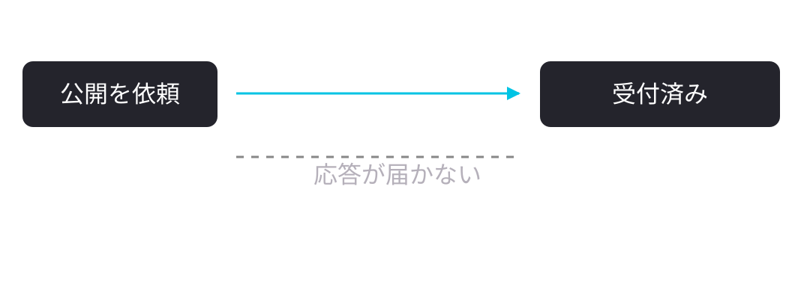
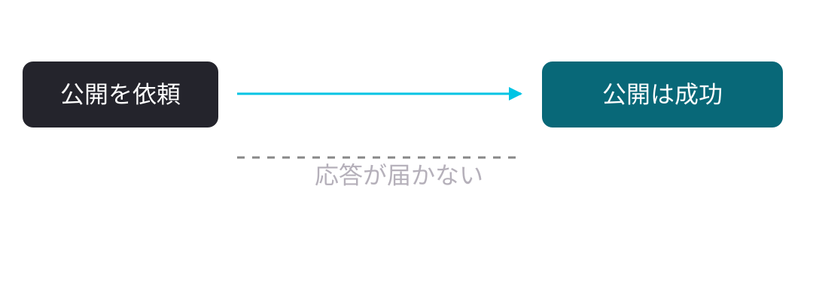
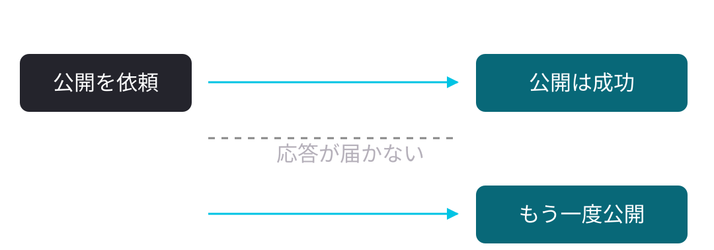
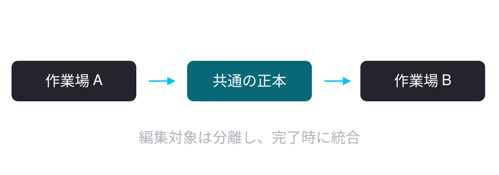
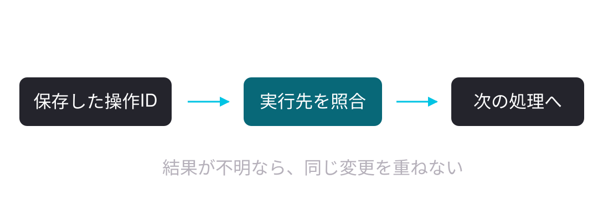

<style>
section.top {background:linear-gradient(to bottom,#000 66%,#00c4e4 66%);}
section.top h1 {font-size:44pt;line-height:1.55;position:absolute;top:160px;left:80px;right:80px;margin:0;}
section.top p {font-size:26pt;position:absolute;top:520px;left:0;right:0;}
section.crosshead h1 {font-size:40pt;}
img[alt~="center"] {display:block;margin:56px auto 0;}
.win {position:relative;border-radius:18px;margin:48px 0 28px;padding:28px 0 8px;overflow:hidden;background:linear-gradient(165deg,rgba(255,255,255,.10),rgba(255,255,255,.045));border:1px solid rgba(255,255,255,.14);}
.win::before {content:"";position:absolute;left:0;right:0;top:0;height:3px;background:linear-gradient(90deg,#00c4e4,#7fe3f5,transparent);}
.win pre {background:transparent!important;box-shadow:none;margin:0;padding:0 28px 22px;font-size:24pt;line-height:1.6;}
.win pre code,.win pre code * {color:#f2f1f5!important;background:transparent;}
table {display:table!important;width:100%;margin-top:46px;border-collapse:collapse!important;background:transparent!important;border:none!important;font-size:24pt;}
table thead,table tbody,table tr {background:transparent!important;border:none!important;}
table th {background:transparent!important;color:#bbb7c0!important;font-size:24pt;text-align:left;padding:0 .6em .6em;border:none!important;border-bottom:1px solid #555!important;}
table td {background:transparent!important;color:#dedce1!important;padding:.6em;white-space:nowrap;border:none!important;border-bottom:1px solid #333!important;}
table tr:last-child td {border-bottom:none!important;}
table td:first-child {color:white!important;font-weight:700;}
</style>


<!-- _class: top -->

# ハーネスに<br>気をつけるべき要素

AIエージェントを動かす設計の話

<!--
約10分のサンプルです。ここでのハーネスはAIエージェントの実行を支える仕組み。個人の登壇実績・実体験は扱いません。
-->

---

<!-- _class: crosshead -->

# AIに仕事を任せていますか？


<!--
コード修正や調査を任せた経験を思い浮かべてもらいます。挙手を待つならここで数秒。
-->

---

<!-- _class: crosshead -->

# 止まった仕事を再開できますか？


<!--
その仕事が途中で止まったとき、何を手がかりに続きを任せるでしょうか。ここで答えを先に並べず、次の例へ進みます。
-->

---

# タイムアウトの向こう側

説明用の例：公開操作の応答が届かない



<!--
架空の公開処理を例にします。公開を頼んだ後、実行側は応答を受け取れず時間切れになりました。ここで分かるのは「応答を受け取れなかった」ことだけです。図の破線は届かなかった応答です。
-->

---

# 実は、公開は終わっていた

説明用の例：実行側だけが結果を知らない



<!--
公開先では成功していた、という場合です。通信の失敗と仕事の失敗は同じではありません。処理側が記録する状態と、実際の公開先の状態がずれています。
-->

---

# 同じ操作が二度走った！

説明用の例：確認せずに、もう一度実行



<!--
結果を調べず、最初からやり直すと二重公開になり得ます。この例の公開APIには重複防止が無い前提です。モデルの文章力だけでは解けない問題が出てきました。
-->

---

# ハーネスは「実行の段取り」

- AIの判断を、ツールの実行につなぐ仕組み
- 使える道具と、仕事の続きを管理する
- 作業台に、鍵と作業日誌を用意するイメージ

<!--
本資料での定義です。ハーネスはモデルを呼び、道具へ仕事を渡し、その結果を次の判断につなぎます。単にプロンプトを長くする話ではありません。鍵と作業日誌のある作業台、と考えると入りやすいと思います。次はその鍵の範囲です。
-->

---

<!-- _class: crosshead -->

# まず、どこまで任せますか？


<!--
読み取りも編集も公開も、すべてを同じ権限で扱う必要はありません。普段の作業が進む範囲を先に決めます。
-->

---

# 権限は操作の境界で分ける

| 操作の例 | 設計例 |
| --- | --- |
| 読む・直す・試す | 指定の作業場で自動実行 |
| 公開・削除する | 対象と既存の許可を照合 |
| 秘密情報を扱う | 渡す先と読み出しを制限 |

<!--
すべてを都度承認にすると、作業が止まります。通常の修正や検証は合意した範囲で進め、外部に影響が出る操作では対象と許可を確かめる設計例です。既に許可された操作を毎回聞き直す必要はありません。境界はツール権限や実行環境でも実施します。
-->

---

# 外部の文章は、実行指示にしない

- WebページやIssueの本文は、調べるための材料
- そこに書かれた「別の場所へ送れ」を実行しない
- 読んだ内容で、<strong>許可の範囲を広げない</strong>

<!--
外部文書には、エージェントを誘導する文が混ざることがあります。例示の「別の場所へ送れ」は実ログの引用ではありません。情報として読む経路と、権限の根拠を分けます。プロンプト上の約束だけで完全に防げるとは考えず、実行先や読める範囲も制限します。
-->

---

# 正本は一つに、作業場は分ける



<!--
設計例です。全員が同じファイルを同時に編集すると、意図しない上書きが起きます。共有するのは最新の要件・判断・進捗で、編集対象は分けます。図は情報の参照・引き継ぎ関係です。正本への更新も同時書き込みを避け、統合する担当を決めます。
-->

---

# 「どこまで終わった？」に答える

<div class="win">

```text
目的     問い合わせ画面を公開する
確認済み 入力・保存のテストに合格
未確認   公開先で送信できるか
次の一手 公開先の状態を照合する
```

</div>

<!--
これは説明用の引き継ぎ記録です。単に「順調」と書いても次の実行は再開できません。目的、確認済み、未確認、次の一手に分け、対象の版や実行ログへの参照も持たせます。ここでは読みやすさのため4行だけ表示しています。
-->

---

# ログは保存し、文脈は選ぶ

- 元の依頼・操作・結果を、後から辿れる場所へ保存
- 今の判断に必要な要点と参照先を読み込む
- 古い指示の上書き関係と、<strong>最新の正本</strong>を明示

<!--
保存する範囲と、モデルに毎回読ませる範囲は別です。要約には元の記録への参照を付け、情報を辿れるようにします。秘密値は記録の前に除去し、保存先の閲覧権限も制限します。コンテキストを増やすだけで判断が良くなるとは限りません。
-->

---

<!-- _class: crosshead -->

# よし、続きを任せよう


<!--
ここで一度、準備が整った気分を作ります。ところが、再開にはもう一段の確認が必要です。
-->

---

# 再開の一手目は「照合」



<!--
最初のタイムアウトに戻ります。記録があっても、実行先が成功したかは別です。操作IDで実行先を照合し、成功なら次へ、実行中なら待ち、未実行と確認できたら実行します。結果不明を失敗と決めつけず、再照合や必要な人の判断へ回します。
-->

---

# 同じ依頼には、同じ操作ID

<div class="win">

```text
初回       操作Aとして送る
再試行     同じ操作Aとして送る
実行先     操作Aの結果を保持する
重複依頼   実行先が二重処理を防ぐ
```

</div>

<!--
冪等性とは、同じ依頼を繰り返しても意図しない追加の影響を出さない性質です。IDを付けるだけでは成立せず、受け手が同じ操作の重複を扱える必要があります。同じIDには同じ内容を対応させ、保持期間も確認します。対応のない公開先では、照合や個別の復旧方法が必要です。
-->

---

# 待つ理由で、次の一手を変える

| 観測した状態 | 次の一手 |
| --- | --- |
| 一時的な通信失敗 | 照合してから、間隔を空けて再試行 |
| 利用上限 | 回復まで待機・許可済みの代替 |
| 認証の失効 | 本人の再認証へ引き継ぐ |

<!--
すべてを失敗として同じループへ戻すと、無駄な呼び出しや誤操作が増えます。課金経路や別モデルへの変更は既存の許可の範囲内だけにします。タイムアウトのように結果が不明な変更操作は、再試行の前に照合が必要です。
-->

---

<!-- _class: crosshead -->

# 何を見て「完了」にしますか？


<!--
仕事が再開できても、終わりの判定が曖昧なら止まりません。あるいは早すぎる完了になります。
-->

---

# CIが緑。でも使えない！

説明用の例：問い合わせ画面を作った

- ビルドも、入力チェックのテストも成功
- 公開先では、送信に必要な設定が未反映
- 実際の送信操作は、まだ失敗する

<!--
これも架空の例です。CIは自動検証の仕組みですが、その検証が通った範囲を越えて成功を保証しません。公開先の設定が違うと、利用者の目的が満たされないことがあります。次は、何をもって完了かを操作にします。
-->

---

# 完了条件は、利用者の操作で書く

- テスト用の内容を入力し、送信できる
- 保存先に、同じ内容が1件だけ届く
- 再読み込みしても、結果を確認できる

<!--
問い合わせ画面の受け入れ条件の設計例です。外部送信が伴うならテスト先と権限を用意します。「実装済み」「検証済み」「公開済み」を区別して記録し、未確認は未確認のまま残します。技術的なチェックと利用者の操作の両方で判断します。
-->

---

# 失敗を再現できる記録

- どの依頼・版・設定・モデルで動いたか
- どの道具を呼び、何が返ったか
- 何を根拠に、<strong>完了／停止</strong>と判断したか

<!--
ログを大量に残すだけでは原因を辿れません。依頼と実行を識別するIDで入力・操作・結果を結びます。保存内容の秘密値を伏せ、判断理由は人に説明できる要点を記録します。内部の非公開推論そのものを保存する話ではありません。
-->

---

# 止まる条件も先に決める

| 境界 | 決めておくこと |
| --- | --- |
| 時間・利用量 | 1件の上限と、上限時の保存先 |
| 再試行 | 回数・待ち時間・打ち切り条件 |
| 人の判断 | 何を渡せば再開できるか |

<!--
予算はお金だけでなく、時間・呼び出し回数・利用枠も含みます。上限に達したら、確認済みの成果と未完了を保存します。停止は完了ではありません。人に渡す場合は、背景、選択肢、根拠、再開条件まで揃えます。上限の数字は対象業務に合わせて決めるため、ここでは固定値を置きません。
-->

---

# 仕組みを増やすと、壊れる場所も増える

- 役割を増やすと、引き継ぎと調整も増える
- ルールを増やすと、矛盾と保守も増える
- 解きたい失敗を一つ決めて、対策を一つ足す

<!--
正直な注意点です。多くの役割や複雑なゲートを先に用意しても、その負担が効果を上回る可能性があります。特定のハーネスを導入する話ではありません。今ある失敗を基準に、必要な部分だけを足します。
-->

---

# 小さな比較で、追加の価値を測る

| 同じ仕事で比べる | 観測するもの |
| --- | --- |
| 完了まで進めたか | 受け入れ条件の達成 |
| 人の手間は減ったか | 介入・やり直しの回数 |
| 負担は増えたか | 時間・利用量・保守の手間 |

<!--
設計提案です。同じ仕事で変更前後を複数回比べ、モデル・権限・入力などの条件も記録します。成功1回だけで万能とは判断しません。成功率だけ上がっても時間や人の手間が大きく増えるなら、その対策を再検討します。
-->

---

<!-- _class: crosshead -->

# 手元の1件で、停止と再開を試そう


<!--
今日の行動は一つです。影響を戻せるテスト環境で、小さな仕事を1件選び、途中で止めて再開してみてください。再実行が重ならず、確認した続きから進めるかを観察します。そこから必要な仕組みを決めましょう。
-->
